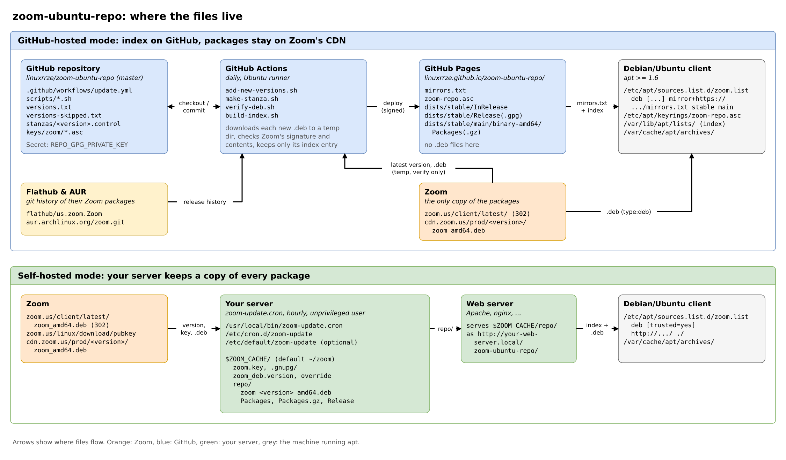

# zoom

The APT repository for the Zoom desktop client. For the client setup see the [main README](../README.md);
this file describes how the repository is maintained. All paths are relative to this directory.

Only amd64 is supported, Zoom publishes no Linux .deb packages for other architectures. Users of the former
`linuxrrze/zoom-ubuntu-repo` repository can switch by replacing their `zoom.list` with the setup from the main
README.



(`docs/zoom-repo-setups.drawio` is the editable source; the PNG also opens as editable diagram in draw.io.)

# How it works

* The index (`dists/stable/...`) is signed with the repository key and lists the SHA256 of every package, so apt
  rejects any .deb from the CDN that differs from the one verified when the version was added.
* Before a version is added, its .deb is downloaded once and checked against Zoom's own signature, including the
  package contents. The .deb itself isn't stored, only its index entry.

# Maintaining the repository

* `versions.txt` lists all known Zoom versions. Only versions with a `stanzas/<version>.control` file
  (their `Packages` entry) are published.
* `scripts/make-stanza.sh <version>` downloads the .deb to a temporary directory, verifies it with
  `scripts/verify-deb.sh` against Zoom's keys in `keys/zoom/` and writes the stanza with
  `Filename: prod/<version>/zoom_amd64.deb`.
* `scripts/build-index.sh <out> <base url> [key id]` builds `dists/stable/...`, signs `Release` and writes
  `mirrors.txt` (index files from `<base url>`, .deb files from `https://cdn.zoom.us/`).
* The workflow (`../.github/workflows/update.yml`) runs every 3 hours (and on pushes):
  `scripts/add-new-versions.sh` adds Zoom's latest version and all releases found via Flathub/AUR that are newer
  than the oldest published version, then the indices are published to `zoom/` on GitHub Pages. A version is
  only recorded in `versions.txt` once it passed verification, so failures are retried on the next run.
* The run fails if Zoom's latest version can't be verified or zoom.us is unreachable; other failures show up as
  warnings. After a Zoom signing key change, add the new public key to `keys/zoom/` (Zoom serves older keys at
  `https://zoom.us/linux/download/pubkey?version=<x-y-z>`; check the fingerprint against Zoom's announcement).
  Versions that can never be verified belong in `versions-skipped.txt`.
* To publish an older version, run `scripts/make-stanza.sh <version>` and commit the new stanza.
  Zoom only reveals its latest version; `scripts/known-versions.sh --missing` lists releases missing from
  `versions.txt`, based on the package history of Flathub and the AUR.

# Self-hosted repository

To serve the .deb files from your own web server instead, adapt the paths in `zoom-update.cron`
(or set `ZOOM_CACHE` in `/etc/default/zoom-update`) and add it to your cron jobs:

```
linux # cp zoom-update.cron /usr/local/bin/zoom-update.cron
linux # echo '0 * * * * nobody /usr/local/bin/zoom-update.cron' > /etc/cron.d/zoom-update
```

Each download is checked against Zoom's signature (key from `https://zoom.us/linux/download/pubkey`), including
the package contents, before it is added. If Zoom changes its key, the script stops until you review the new key.
The repository is a flat one (`Packages`, `Packages.gz`, unsigned `Release`), see the commented line in
`zoom-repo-example.list`.

To add a single version manually from a checkout of this repository, run `./fetch.sh [<version>]`
in this directory (it uses the keys in `keys/zoom/`).

# Background

Parsing the Zoom homepage got harder and harder, but here's what I got as a workaround from Zoom:
(mind the URL containing the current version number):

```
linux # wget --spider https://zoom.us/client/latest/zoom_amd64.deb | grep ^Location:
Spider mode enabled. Check if remote file exists.
--2022-02-01 07:49:17--  https://zoom.us/client/latest/zoom_amd64.deb
Resolving zoom.us (zoom.us)... 170.114.10.74
Connecting to zoom.us (zoom.us)|170.114.10.74|:443... connected.
HTTP request sent, awaiting response... 302 
Location: https://cdn.zoom.us/prod/5.9.3.1911/zoom_amd64.deb [following]
Spider mode enabled. Check if remote file exists.
--2022-02-01 07:49:17--  https://cdn.zoom.us/prod/5.9.3.1911/zoom_amd64.deb
Resolving cdn.zoom.us (cdn.zoom.us)... 99.84.89.248
Connecting to cdn.zoom.us (cdn.zoom.us)|99.84.89.248|:443... connected.
HTTP request sent, awaiting response... 200 OK
Length: 56825388 (54M) [binary/octet-stream]
Remote file exists.
```

So in order to get the latest version number, do this:

```
linux # wget --spider https://zoom.us/client/latest/zoom_amd64.deb 2>&1 | grep ^Location: | sed -e 's/.*prod\/\(.*\)\/.*/\1/'
5.9.3.1911
```
